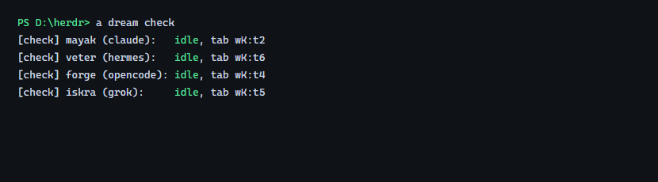

# Herdr Dream Team Squad

   [🇬🇧 English](README.en.md)

**Dream Team Squad** — команда из четырёх AI-агентов для Herdr TUI, собранная по скиллу [herdr-setup](https://github.com/Kkoder-Cyclone/Herdr-skill-setup):

- **Маяк** (Claude) — лид: цель, план, раздача, приёмка;
- **Гермес** (Hermes) — заместитель: аудит, ревью, координация;
- **Forge** (OpenCode) — тяжёлый код и серверы;
- **Грок** (Grok) — мост: быстрый поиск, черновики, связь.

Маршрут: **пользователь → Маяк → Гермес → Forge / Грок → Маяк → пользователь**.

Проверенный стек — **Herdr TUI**. GUI-оболочки не включены: ветка GUI ждёт проверки.

---

## Как устроено

```
herdr TUI
└─ workspace «Dream Team Squad»
   ├─ таб «Маяк · Claude — лид»      ← лид команды
   ├─ таб «Гермес · Hermes — зам»    ← заместитель, аудит
   ├─ таб «Forge · OpenCode»         ← тяжёлый код
   └─ таб «Грок · Grok»              ← мост и поиск
       внутри вкладки агента: инструменты, браузер файлов, диффы
```



---

## Команды

```
a dream all                    # поднять всех четверых
a dream mayak                  # только Маяк
a dream veter                  # только Гермес
a dream forge                  # только Forge
a dream iskra                  # только Грок
a dream check                  # статусы четверых
a dream mayak <папка-проекта>  # запуск в папке проекта
```

Идемпотентно: живой агент — «уже работает», дублей нет.

---

## Что внутри

| Файл | Что это |
|---|---|
| `docs/ARCHITECTURE.md` | Архитектура: роли, маршрут, Git-цикл |
| `docs/SETUP.md` | Пошаговая сборка со скриншотами |
| `agents/` | Рабочие места: mayak, veter, forge, iskra (AGENT.md каждого) |
| `examples/wrappers/` | Рабочий движок dream.js + dream.cmd |
| `plugins/`, `projects/`, `skills/` | Те же правила, что в star-wars-squad |
| `screenshots/` | Скриншоты (только TUI) |

---

## Быстрый старт

1. Поставь Herdr TUI: `irm https://herdr.dev/install.ps1 | iex` (Windows).
2. Дай агенту скилл [herdr-setup](https://github.com/Kkoder-Cyclone/Herdr-skill-setup).
3. Скажи: «Собери команду Dream Team Squad по скиллу herdr-setup».
4. Или собери по [docs/SETUP.md](docs/SETUP.md).

## Требования

1. Herdr TUI 0.9+. 2. Claude, Hermes, OpenCode, Grok — установлены и авторизованы. 3. Node.js 20+. 4. Git.

## Лицензия

[MIT](LICENSE) — открыто, бесплатно, без гарантий.
