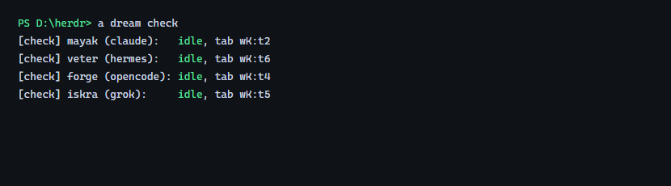
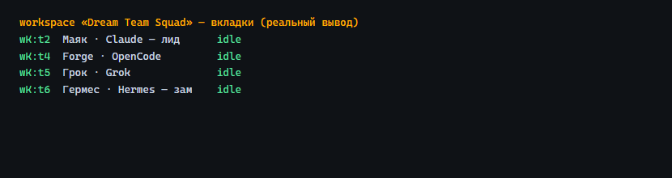

# Сборка Dream Team Squad в Herdr TUI

## 1. TUI и CLI

```powershell
irm https://herdr.dev/install.ps1 | iex
herdr --version
```

Claude, Hermes, OpenCode, Grok — установлены и авторизованы.

## 2. Workspace и агенты

Вариант А — скажи агенту со скиллом herdr-setup: «Собери команду Dream Team Squad».
Вариант Б — руками:

```
herdr workspace create --label "Dream Team Squad"
herdr tab create --workspace <ID> --cwd <место агента>
herdr agent start mayak --kind claude --pane <pane> --timeout 90000
herdr agent start veter --kind hermes  --pane <pane> --timeout 90000
herdr agent start forge --kind opencode --pane <pane> --timeout 90000
herdr agent start iskra --kind grok --pane <pane> --timeout 90000
```



## 3. Общие инструкции

Положи AGENTS.md в cwd каждого агента: состав, маршрут, границы. Шаблон — [examples/instructions/AGENTS.md](../examples/instructions/AGENTS.md).

## 4. Команды запуска

Скопируй [examples/wrappers/dream.js](../examples/wrappers/dream.js) и `dream.cmd` в `bin/`; поправь ROOT. Затем:

```
a dream all | mayak | veter | forge | iskra | check [папка-проекта]
```



## 5. Приёмка

`a dream check` — четверо с статусами; повторный `a dream all` — без дублей; `a dream mayak <папка-проекта>` — cwd проекта, профиль свой.
